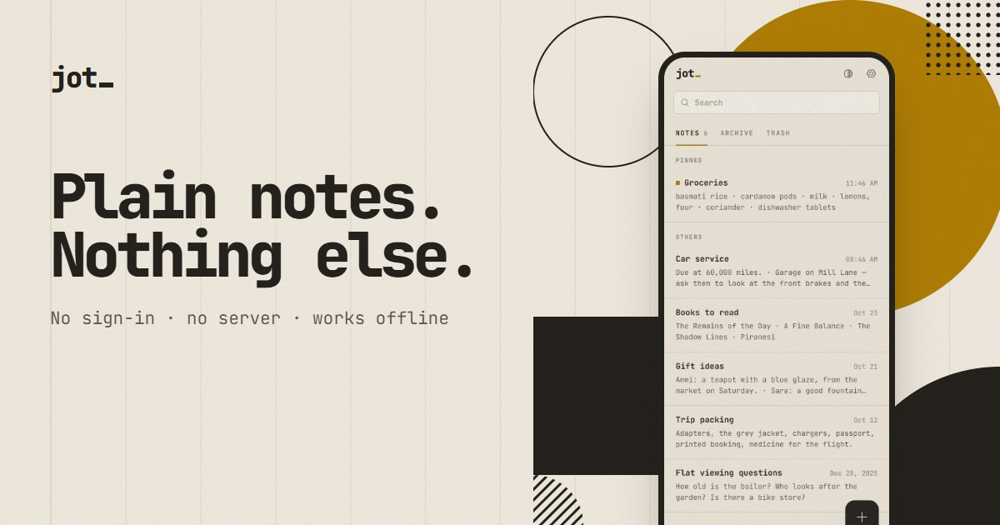
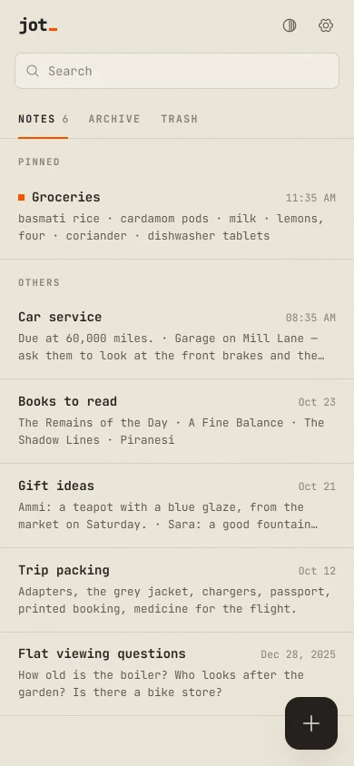
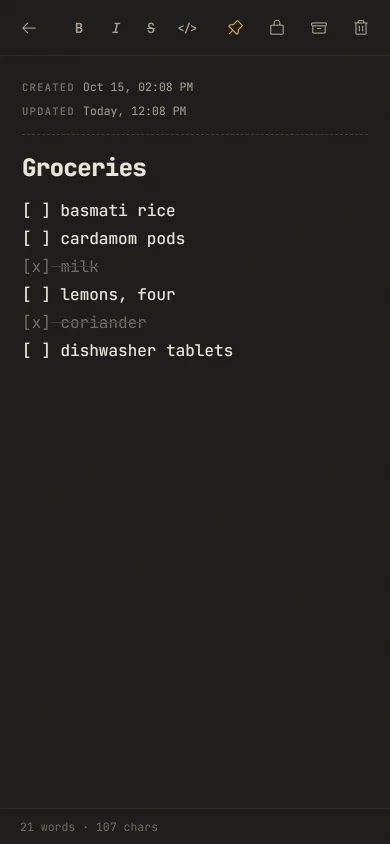
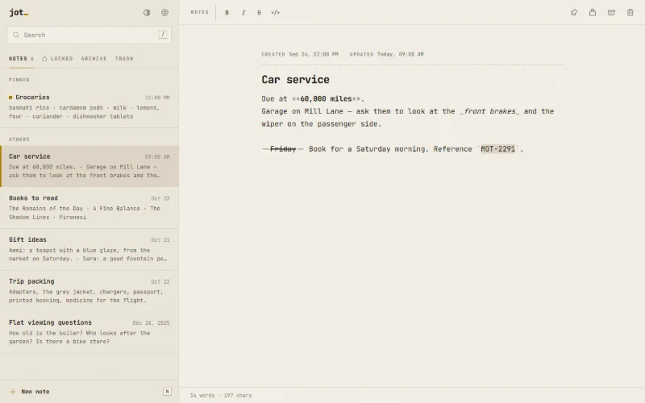

#  Jot

Plain notes. Nothing else. A quiet notes app for Android and the web: no sign-in, no server, no tracking. Notes stay on your device, open offline, and show when each one was created and last updated.

<a href="https://mhfrough.github.io/jot/"></a>

**Open the app:** https://mhfrough.github.io/jot/app/ &nbsp;·&nbsp; **Site:** https://mhfrough.github.io/jot/ &nbsp;·&nbsp; **Licence:** [MIT](LICENSE)

## What it does

Jot replaces Simple Notes on an Android phone. It keeps what made that app good, plain and quick, and drops everything else.

| Part | What you get |
| --- | --- |
| Notes | As many as you like, saved as you type, with an optional title |
| Dates | Created and updated, day and time, at the top of every note |
| Search | Titles and text, as you type, with matches marked |
| Pins | Pinned notes stay above the rest |
| Checklists | Plain `[ ]` lines; tap the box to tick it; lists carry on when you press Enter |
| Archive and trash | Put away or delete with an undo; the trash empties after 30 days |
| Look | Paper (light) or carbon (dark), mono or sans, three text sizes, sort by updated, created or A–Z |
| Export and import | One JSON file with everything; imports Simple Notes and Fossify Notes exports and `.txt` files |
| Offline | Installs as an app from the browser and opens with no network |

<p>
  
  
</p>


## Where notes live

In the browser's IndexedDB on the device you use, and nowhere else. There is no Jot server and no account, so there is nothing to sync and nothing to leak. Clearing the site's data in the browser deletes the notes, so export a copy from Settings now and then.

## Run it

The app is plain files. Serve the folder and open `/app/`:

```bash
npm run serve
```

Then open http://localhost:8190/ for the site and http://localhost:8190/app/ for the app. Service workers need `localhost` or HTTPS.

## Tests

End-to-end in real Chrome with Playwright (`playwright-core`):

```bash
npm install
npm test
```

| Test | Checks |
| --- | --- |
| Opens straight away | No sign-in, no password field, no request leaves the site |
| Save and dates | Notes in IndexedDB, back after reload, created stays, updated moves on edit, word count |
| Empty note | A new note that is never written in is not kept |
| Pin, archive, trash | Pin order, undo, archive and back, read-only trash, restore, delete forever, empty trash |
| Search | Filters and marks matches, empty state |
| Checklists | Tap to tick, Enter carries a list on, Enter on an empty item ends it |
| Export and import | Export file, import on a new device, duplicates skipped, Simple Notes and text files |
| Settings | Theme, font, size and sort apply and survive a reload |
| Phone | No sideways scroll at 390 px, editor over the list, browser back closes the note |
| Offline | The service worker serves the app with the network off |
| Website | Every page loads with no errors and no sideways scroll at 390 px |

`npm run shots` retakes the screenshots in `assets/img/`; `node tools/icons.mjs` renders the app icons and the social card; `npm run pages` builds the inner pages.

## Files

| Path | What it holds |
| --- | --- |
| `app/index.html`, `app/app.js` | The app: list, editor, settings, export and import |
| `app/db.js` | IndexedDB storage |
| `app/sw.js`, `app/manifest.webmanifest` | Offline cache and install |
| `css/paper.css` | The shared font and colours: paper, ink, one ochre signal |
| `css/app.css`, `css/site.css` | The app and the website, plain CSS with no build step |
| `index.html`, `js/site.js` | The website |
| `privacy/`, `terms/`, `cookies/`, `credits/`, `sitemap/` | Inner pages, built by `tools/pages.py` |
| `tests/` | Playwright tests and the screenshot script |
| `PLAN.md` | Design notes: research, decisions and a self-critique |

## Credits

| Work | By | Licence |
| --- | --- | --- |
| JetBrains Mono | JetBrains | SIL OFL 1.1 |
| Phosphor Icons | Helena Zhang, Tobias Fried | MIT |

## Licence

MIT. Made by [Mohammad Hamza](https://github.com/mhfrough).
